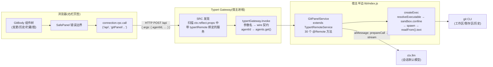
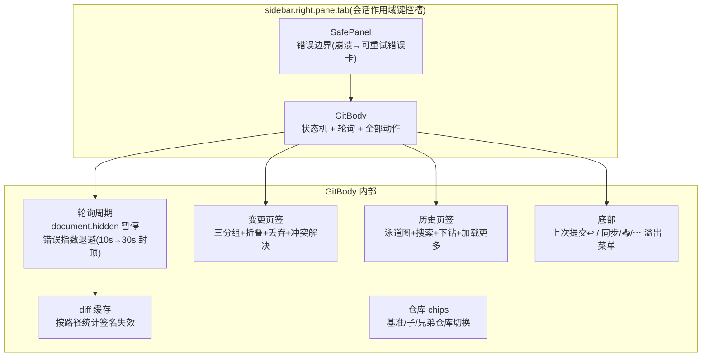
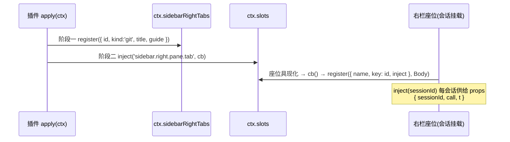
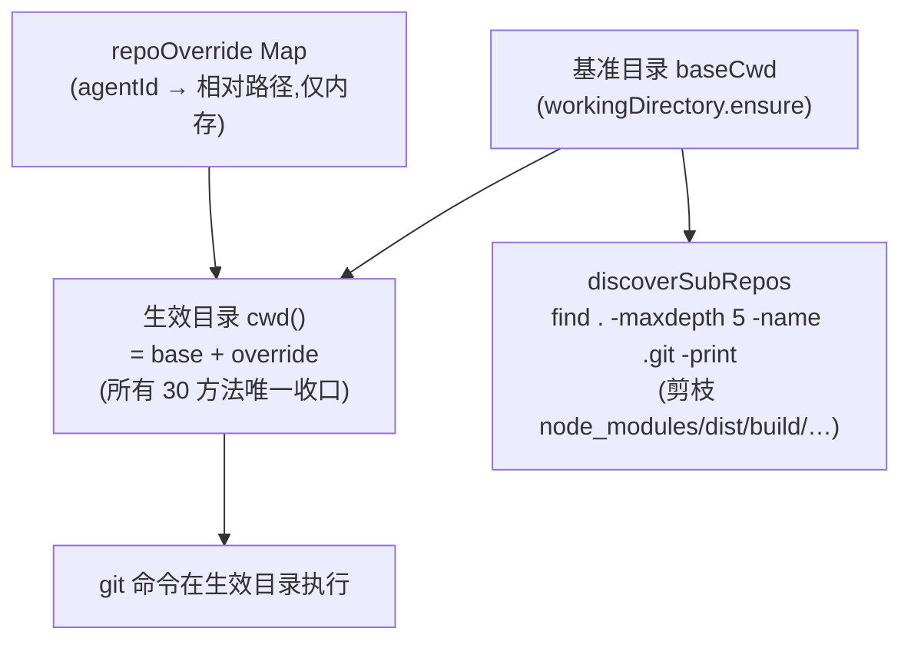
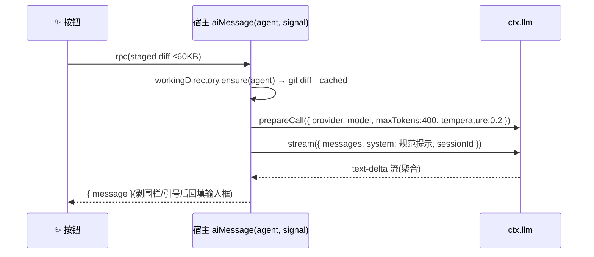

# 架构(ARCHITECTURE)

> 本文描述 dsh-git-panel v0.5.x 的真实实现。所有机制均经源码级验证(DeepSeek Harness 0.2.1-rc.x)。
> 历史设计文档见 [DESIGN.md](DESIGN.md)(M0 时期规划,部分已被本文取代)。

## 1. 总体架构

插件是**双面(Dual-face)包**:宿主半边跑在 Harness 主进程里封装 git CLI,浏览器半边渲染右栏页签。两侧唯一的通信通道是 Harness 平台提供的 **Typert Gateway**(JSON-RPC over `/api`)。



要点:

- **浏览器半边不感知 git**,一切经白名单 RPC;宿主半边不感知 UI,只返回可序列化 JSON。
- **`host.call` 不是本插件用的通道**(那是动态 cordis 包的专用 RPC);本插件走平台通用的 `connection.rpc.call`。

## 2. 通信契约(SRC 模式)

宿主服务不需要生成工件即可暴露 —— Gateway 的 **source-mode discovery** 扫描 `ctx.reflect.props`,发现带 `typertRemote` 绑定的服务实例,再读原型上的方法标记(`@deepseek-ai/dsh-typert-protocol/remote-methods`,version 1)。

**方法参数名就是 wire 契约**(SRC 解析器按参数名匹配):

| 参数名 | wire 键 | 语义 |
|---|---|---|
| `agent` | `agentId` | 全局 agent lookup:`agents.get(sessionId)` 解析成 Agent 实例 |
| 其他任意参数 | 参数名本身 | src-json 透传 |
| `signal`(必须最后) | — | 网关注入的取消信号 |

调用侧(浏览器)因此长这样:

```js
connection.rpc.call('/api', 'gitPanel/status',
  { args: { agentId: sessionId } }, signal)
// 响应包: { ok: true, value } / { ok: false, error: { code, message, details } }
```

### 2.1 Remote 方法清单(30 个)

| 分组 | 方法(参数 → wire) |
|---|---|
| 仓库 | `discoverSubRepos(agent)`(内部);`selectRepo(agent, root)`(会话级子仓库选择) |
| 查询 | `status(agent)`;`diff(agent, path, staged)`;`diffUntracked(agent, path)`;`diffAll(agent)` |
| 暂存 | `stage(agent, paths)`;`unstage(agent, paths)`;`stageAll(agent)`;`unstageAll(agent)` |
| 提交 | `commit(agent, message)`;`commitTracked(agent, message)`(=-a);`undoCommit(agent, confirm)`;`amend 暂缺` |
| 历史 | `history(agent, limit, path)`(path=单文件历史);`showCommit(agent, hash)`;`commitFileDiff(agent, hash, path)`;`stashDiff(agent, ref)` |
| 分支 | `checkout(agent, name)`;`createBranch(agent, name, startPoint)`;`deleteBranch(agent, name, confirm)`;`tag(agent, name)` |
| 远端 | `fetch(agent)`;`pull(agent, rebase)`;`push(agent)`(无上游自动 -u);`pushForce(agent, confirm)`(**仅 --force-with-lease**) |
| 贮藏 | `stashSave(agent, mode)`(all/tracked/staged);`stashList(agent)`;`stashApply(agent, ref)`;`stashPop(agent, ref)`;`stashDrop(agent, ref, confirm)` |
| 修复 | `discard(agent, paths, confirm)`;`resolveConflict(agent, path, side)`(ours/theirs) |
| AI | `aiMessage(agent, signal)`(signal 必须是最后参数 → 网关注入取消) |

> 共 **32** 个方法;`confirm` 参数的方法(undoCommit/deleteBranch/pushForce/stashDrop/discard)必须显式传入,否则宿主拒绝。

## 3. 客户端结构(lib/client.js,自包含单文件)



### 3.1 页签两阶段注册(与官方 ui-sidebar-terminal 同款)



- 阶段一决定**页签芯片 + 引导页入口**(guide);阶段二决定**主体渲染**。
- 标题席位 `sidebar.right.pane.tab.title` 同 key 注册(纯文本)。
- 整个 GitBody 被 **SafePanel** 包裹:`getDerivedStateFromError` 捕获渲染崩溃 → 显示异常信息 + 重试按钮。

### 3.2 轮询与缓存

```mermaid
sequenceDiagram
    participant T as 定时周期
    participant B as GitBody
    participant H as 宿主 status()
    loop 每 5s(页面隐藏时只空转;恢复可见立即刷)
        T->>B: cycle()
        B->>H: rpc status
        H-->>B: 'ok' | 'stale' | 'fail'
        alt fail
            B->>B: 退避 ×2(上限 30s)
        else ok
            B->>B: backoff=0;按统计签名修剪 diff 缓存
        end
    end
```

- **diff 缓存签名** = `该路径 +n/−n 统计`;status 回来后逐 key 比对,变了就收起该行并丢弃过期 diff,**未变的行不闪断**。
- status 宿主侧每次仅 5 次 git spawn(合并 rev-parse、合并 numstat)。

### 3.2.1 刷新策略(流优先,轮询兜底)

- **事件流活跃**:`workspaceFiles.changes` 每 change 帧 → 300ms 防抖刷新;轮询降为 **30s 兜底**
- **流断开**:自动指数重连(3s→30s 封顶),重连期间轮询回到 5s
- **页面隐藏**:轮询空转(30s),恢复可见立即刷新一次
- **错误**:连续失败指数退避(10s→30s 封顶),成功即复位

子仓库切换时,展开状态 / diff 缓存 / 历史缓存全部重置 —— 跨仓库的同路径文件不再显示旧仓库的数据。

### 3.3 页签持久化(反白屏的第二道闸)

GitBody 因座位重挂载、右栏开合而重建时,页签状态从**模块级变量 `LAST_TAB`** 恢复;
页面刷新则从 **sessionStorage**(`gitPanel.tab`)恢复。双写双读,覆盖全部重建路径。
另有挂载/卸载诊断日志(控制台 `[git-panel] GitBody mounted/unmounted`),用于定位重挂载时机。

### 3.3.1 泳道图算法(layoutGraph)

- `lanes[i]` = 第 i 条泳道正在等待的提交哈希;逐条(新→旧)认领泳道,第一父延续,其余父分叉(合并线),根提交消耗殆尽的泳道压缩移除。
- 行内渲染为 SVG:直线(同列)+ 三次贝塞尔(跨列);HEAD 圆环;泳道上限 `LANES_MAX=10`(防挤占文本列)。
- 该函数经 `__graphLayout` 导出,测试**直接测出货代码**(非副本)。

### 3.4 词级 diff

相邻 `−行`/`+行` 配对,按字符剔除公共前后缀得"变化中段",中段加深底色(红/绿),整行底色保持淡色。超过 `DIFF_MAX_LINES=400` 行截断并提示。

### 3.5 多仓库支持(子仓库发现与会话级选择)

工作区目录本身不是仓库、但子目录里有仓库时(或需要在多个内嵌仓库间切换),面板顶部出现
**仓库 chips**(基准仓库 + 发现的子仓库,当前项高亮),点选即切换。



- **发现**:`find` 下探 5 层找 `.git`(目录或 worktree 文件),剪枝 node_modules/dist/build/vendor/.venv/venv/target 重目录;命中 `.git` 的目录(含 `a/b/仓库` 多层形式)作为 chip 展示。
- **选择**:`selectRepo(agent, root)` 校验(拒绝绝对路径与 `..`,且必须是仓库)后写入内存表;`cwd()` 对所有方法统一应用 override —— 单点收口,30 个方法零改动获得多仓库能力。
- **清除**:点击基准仓库 chip(root='')即恢复。
- 五种布局场景(仓库内+兄弟、非仓库+子仓库、已选子仓库、单仓库、非仓库无子仓库)均有渲染断言。

## 4. AI 提交信息(aiMessage)



- 模型取 `agentDefaultModel.currentSelection()`;未配置默认模型时报错直达面板。
- 与官方 session-title-llm 同款一次性调用姿势(`prepareCall → stream`)。

## 5. 模块加载与部署(两次事故的机制性修复)


**事故复盘:**

1. **代际混搭**(`numstatCombined is not a function`):Node ESM 按**文件路径**缓存模块。`link:` 直装的路径永远不变,不同文件在不同时期被导入并缓存 → index.js 新、git.js 旧。→ **版本化部署**:每次发布复制到 `deploy/<版本>/` 全新路径,URL 全新,缓存必然失效。
2. **分支互踩**(用户切分支测试 ↔ 脚本提交/部署):deploy 改为 `git archive HEAD`,**只认已提交内容**;配合"先验证后提交"纪律,脏工作区与用户分支操作都无法污染部署。

## 6. 测试策略

| 层 | 手段 | 断言对象 |
|---|---|---|
| 纯函数 | node --test(test/git-parse.test.mjs,26 条之一部分) | porcelain v2 / log / numstat / 分支 / 词级段 |
| git 封装 | 假 exec(argv 断言)+ 真实临时仓库端到端 | 白名单操作、confirm 门、无强推结构断言 |
| 图布局 | 无头装配取 `__graphLayout` | 线性/分叉/合并/过滤子集 |
| 组件 | react-dom/server **渲染矩阵**(真正执行函数体) | __testables 全组件 × 真实数据 |
| 边界 | SafePanel.getDerivedStateFromError | 崩溃→错误卡 |

> `__testables` / `__graphLayout` 是模块返回对象上的测试接缝:**测试直测出货代码**,零副本零漂移。

## 7. 目录结构

```
git-panel/
├── lib/
│   ├── index.js        # 宿主:GitPanelService(TypertRemoteService,SRC)
│   ├── client.js       # 浏览器:页签注册 + 面板(自包含单文件)
│   ├── git.js          # git 封装与解析(零依赖,可独立单测)
│   ├── exec.js         # subprocess/sandbox → exec 缝合(git 前缀在此补)
│   └── client-logic.js # 纯逻辑(relTime 等;client.js 内有同步副本)
├── test/               # 26 单测(git-parse / git-graph / client-logic)
├── deploy/<版本>/      # deploy.sh 产物(版本化安装源,gitignored)
├── dist/               # package.sh 检查点 zip(gitignored)
├── deploy.sh           # HEAD 已提交内容 → deploy/<版本>/
├── package.sh          # HEAD 已提交内容 → dist/*.zip
├── cordis.patch.yml    # loader 行(insert: git-panel)
├── locale/zh|en.json   # Plugins 页元数据
└── icon.svg            # 原创图标
```

## 8. 已知边界

- `numstat` 的 rename 路径(`old => new` 形态)不计 ± 统计(行上无数字,悬停可看 origPath)。
- 未跟踪文件的 diff 为"全 +"视图(`--no-index` 对空设备),二进制文件显示"(二进制文件)"。
- 历史单次最多 200 条(加载更多步进 100);泳道上限 10。
- `pull --rebase`、强推、discard、删分支、tag 均有确认门(两击或显式 confirm 参数)。
