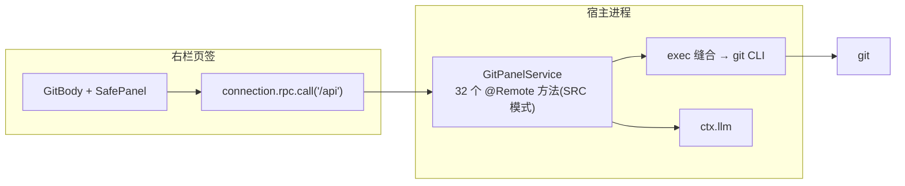

# @deepseek-ai/dsh-git-panel

Zed 风格的 Git 面板,DeepSeek Harness 右栏页签。双端插件、零构建、纯 JS。
**当前版本 v0.6.2** · 变更记录见 [CHANGELOG.md](CHANGELOG.md) · 架构与机制见 [ARCHITECTURE.md](ARCHITECTURE.md)

## 功能

- **变更页签**
  - 三分组列表(已暂存 / 变更 / 未跟踪,可折叠)+ 冲突分组
  - 按文件勾选暂存/取消;每文件 ±n 统计;行内 diff(**词级高亮**);未跟踪文件全 `+` 视图
  - 丢弃改动(行悬停 ↩ 两击确认);冲突行 ⟪用当前 / ⟫用传入
  - ✨ AI 生成提交信息(宿主侧一次性 LLM 调用,使用会话默认模型)
  - 提交(⌘/Ctrl+Enter)+ **提交已跟踪**(-a)+ 字数提示(首行 >72 警示)
- **历史页签**
  - **Git Graph 泳道图**:彩色泳道、贝塞尔分叉/合并、HEAD 圆环、tag/分支徽章、作者头像
  - 提交搜索(n/m 计数)、点选节点下钻:变更文件列表 + 单文件 diff + 提交正文
  - 加载更多(步进 100)
- **分支与多仓库**:切换、新建(创建即切换)、删除(两击确认,当前分支不可删)、HEAD 建标签;
  **子仓库发现**(下探 5 层,剪枝 node_modules 等重目录)—— 工作区非仓库时出选择器,
  工作区内嵌多个仓库时出切换 chips,选中的仓库对所有功能生效
- **远端**:Fetch / Pull / **Pull --rebase** / Push(无上游自动 `-u`)/ 强推(仅 `--force-with-lease` + 两击)
- **贮藏**:全部(-u)/ 仅已跟踪 / 仅已暂存;列表应用 / 弹出 / 删除(两击);内容 diff 视图
- **底部**:上次提交 + ↩ 撤销(两击,soft reset);贮藏入口/溢出菜单
- **页签记忆**:重挂载/右栏开合/页面刷新后回到停留的页签
- **工程质量**:轮询页面隐藏暂停 + 错误指数退避;status 每次 5 次 git spawn;diff 缓存按统计签名
  失效;SafePanel 错误边界(崩溃→可重试错误卡);泳道数上限;中英文案跟随界面语言

## 架构一览



完整的组件图、时序图、通信契约、泳道算法、测试策略、事故复盘见 **[ARCHITECTURE.md](ARCHITECTURE.md)**。

## 开发

```sh
pnpm install            # 依赖(typert-protocol / cordis / react / react-dom)
pnpm test               # 26 测试(纯函数 + 假 exec argv + 真实仓库端到端 + 图布局)
./package.sh            # 检查点 zip(只归档已提交内容;先 commit 再打包)
./deploy.sh             # 版本化部署拷贝(HEAD 已提交内容 → deploy/<版本>/)
```

**迭代纪律**(两次事故换来的):

1. 改完 → `pnpm test` 全绿 → `git commit`
2. `./deploy.sh`(从 HEAD 已提交内容打包,**与工作区分支状态解耦**)
3. remove + install(版本化路径 = 全新模块生成,无缓存混搭)
4. 页面 Cmd+R

## 安装

在会话内让 Agent 用 plugin_manager `install_bundle` 指向本目录(或 `deploy/<版本>/`),
也可 `dsh plugin --profile <name> add "$(pwd)"`。刷新 GUI,右栏引导页点「Git」。

> 依赖说明:宿主运行时 import `@deepseek-ai/dsh-typert-protocol` 与 `@deepseek-ai/cordis`,
> 靠插件目录内 `node_modules` 解析(link/file 均可),已在 `pnpm add -P` 时固定版本。

## 文档

- [ARCHITECTURE.md](ARCHITECTURE.md) — 架构图(Mermaid)、通信契约、算法、测试策略、事故复盘
- [CHANGELOG.md](CHANGELOG.md) — 版本变更记录
- [DESIGN.md](DESIGN.md) — M0 时期历史设计(已被 ARCHITECTURE.md 取代)

## 路线图

明确不做:行内 blame / gutter 标记(编辑器表面)、split diff、permalink/托管跳转、worktree(另用 DSH 实验工具)。
候选:多仓库切换、rebase/cherry-pick 类重操作(独立立项)。
